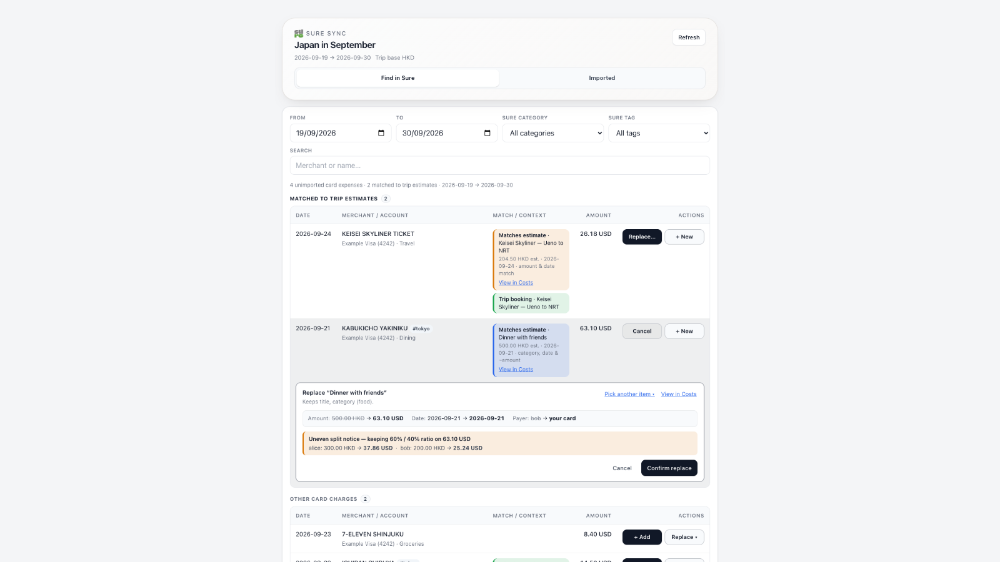

# Sure Sync (`sure-expense-import`)

Import selected Sure card expenses into a TREK trip budget in their native currency with 1:1 mapping and non-destructive drift checks.



## What it does

Sure Sync adds a **Sure Sync** tab inside every TREK trip planner. It connects read-only (`GET`-only) to your self-hosted Sure personal-finance ledger over Sure's REST API (`/api/v1`, via any HTTPS domain or local container URL you configure), lists charges across all active `credit_card` accounts within the trip's date window, floats charges that match unmapped TREK estimates to the top, and syncs each charge individually either as a brand-new cost (**+ Add**) or as an in-place replacement of a manual estimate (**Replace…**).

Each imported Sure transaction maps 1:1 to a TREK `budget_items` entry in the transaction's native currency (`USD`, `HKD`, `SGD`, etc.) and stamps a `sure:<id>` provenance note. Replacing an estimate updates `total_price`, `currency`, `expense_date`, and `payers` in place via `ctx.costs.update` — preserving the human TREK title, category, notes, attached receipts, booking/place links (auto-resyncing linked reservation prices), and equal splits, while proportionally rescaling uneven custom splits with an explicit ratio notice before you confirm. Unmapped TREK items are never modified unless you confirm a replacement, and nothing is ever written back to Sure.

On each load, the plugin checks imported snapshots against Sure via direct UUID lookup (`/api/v1/transactions/:id`, with a single-page date-range prefetch when >8 items are mapped) and surfaces drift badges (`ok`, `changed`, `not-expense`, `missing`, `edited-in-trek`) without ever auto-deleting or silently rewriting trip totals.

## Screenshots

The trip tab is split into two views behind a segmented control:

- **Find in Sure** — date range (defaulting to the trip's start and end dates; widen either end for pre-booked flights and hotels), plus Sure category, Sure tag, and free-text drilldowns. Charges correlating to unmapped trip estimates float to **Matched to Trip Estimates** at the top with a 2-click **Replace… → Confirm replace** preview (including uneven-split ratio notices and **Pick another item ▾**); remaining charges sit under **Other Card Charges** with 1-click **+ Add** and manual **Replace ▾**.
- **Imported** — the mapped items on this trip with their live Sure drift status, and per-row **Refresh from Sure** / **Unlink** / **Delete in TREK** actions.

Styled with the native TREK design kit in both light and dark themes, and laid out for desktop, tablet, and phone widths.

## Permissions

| Permission | Why |
|---|---|
| `db:own` | Stores the private `imports` SQLite mapping table (`UNIQUE(sure_transaction_id)`) and import-time snapshots for idempotency and drift detection. |
| `db:read:trips` | Reads the active trip's title, start/end dates, and base currency to scope candidate transactions. |
| `db:read:costs` | Reads the trip's existing budget items to prune deleted mappings, correlate unmapped estimates for replacement, flag duplicates, and detect `edited-in-trek` items. |
| `db:write:costs` | Creates a budget item on **+ Add**, updates an unmapped estimate in place on **Confirm replace**, refreshes a mapped item on explicit per-row **Refresh from Sure**, and optionally deletes on unlink. |
| `rates:read` | Reads TREK's cached exchange rates to correlate cross-currency estimates and duplicates without extra network egress. |
| `http:outbound` (`operatorEgress: true`) | Allows the instance admin to authorize their own self-hosted Sure hostname (`sure.example.com`, `*.example.com`, or a Docker service name) under **Allowed hosts** for `GET`-only `/api/v1/{accounts,categories,tags,transactions}` calls. No hardcoded external host is bundled. |

## Setup

1. Ensure the **Costs** (`budget`) addon is enabled in **Admin → Addons**.
2. Copy the packed plugin into `/app/data/plugins/sure-expense-import/` (or upload `plugin.zip`) and click **Rescan** in **Admin → Plugins**.
3. Open **⋯ → Allowed hosts** on the **Sure Sync** row and add your Sure hostname (for example `sure.example.com`, or `sure` if connecting over a shared Docker network with `TREK_PLUGIN_ALLOW_PRIVATE_EGRESS=on` on TREK).
4. In Sure, open **Settings → API Keys** and create an API key (`read` scope is sufficient).
5. Enable the plugin, then open **⋯ → Instance settings**, set **Sure base URL** (e.g. `https://sure.example.com` or `http://sure:3000`), paste **Sure API key**, save, and click **Test connection**.

The **Find in Sure** view is admin-only (the key is instance-wide). Trip editors who are not admins still see the **Imported** tab for their trips.

## Security

The plugin is read-only toward Sure (`GET` only, redirects refused so the key can never be forwarded), sends the API key as `X-Api-Key`, and never exposes it to the browser. The Sure URL and key are instance-scoped, so only a TREK admin can set them; the key is stored encrypted by TREK. Outbound traffic is restricted to the hosts the admin adds under **Allowed hosts**.

Because one instance-wide key reaches the operator's whole ledger, **browsing and importing are admin-only**: `/candidates` and `/import` refuse a non-admin even on a trip they edit. Other trip editors still see the trip's **Imported** tab and can refresh or unlink those costs. Importing at most 25 charges per request keeps one call from hammering Sure.

A LAN/loopback Sure host needs `TREK_PLUGIN_ALLOW_PRIVATE_EGRESS=on` on the TREK server. That switch relaxes the private-address block for **every** installed plugin, not just this one — enable it only if you trust them all.

To report a vulnerability, use a private GitHub security advisory — see [SECURITY.md](SECURITY.md).

## Development

Requires Node.js 22.13+ (tests use the built-in `node:sqlite`). No TREK or Sure instance is needed — tests run against `trek-plugin-sdk`'s mock host.

```sh
npm ci
npm test          # unit tests
npm run validate  # manifest checks the registry runs
npm run dev       # hot-reloaded TREK frame for manual testing
```

See [CONTRIBUTING.md](CONTRIBUTING.md).

## License

MIT License — Copyright (c) 2026 Herman Mak.
